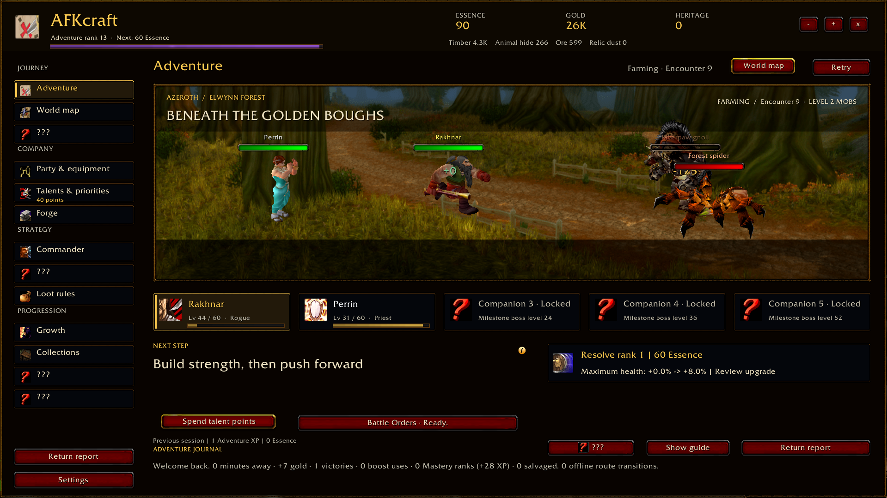
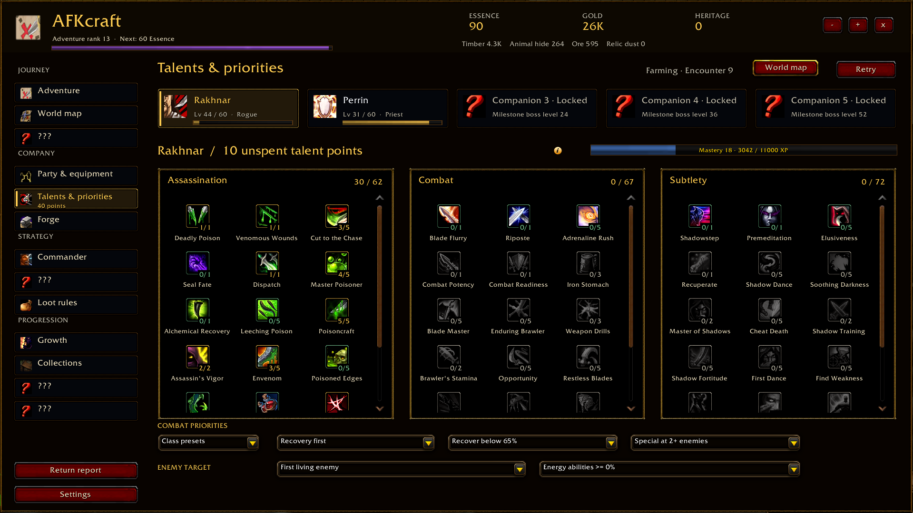
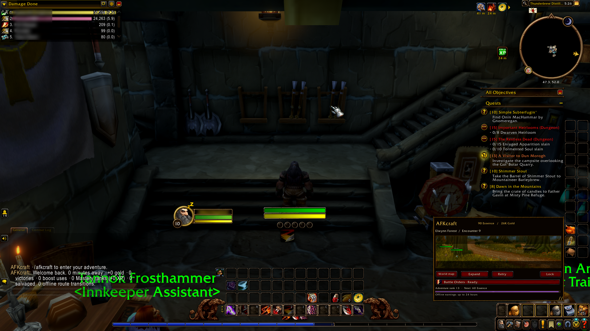

# AFKraft : WoW Idle Game

**A little party. A long adventure.**

Your next dungeon group is still forming. Somewhere in Azeroth, your other party is already fighting.

AFKraft is an idle party RPG that lives inside World of Warcraft. Start with one hero, recruit companions, and build a company of five. Send them across Azeroth to fight, bring home loot, and take on tougher bosses while you play your own character.

Check in for a new weapon, rethink a talent build after a defeat, or pick the next zone to explore. Then let the party get back to work.

## Build a party worth checking in on

Start with your character's identity and class, then discover more companions as you defeat milestone bosses. Choose from all nine original classes, mix roles, or double up on a favorite. Log in on an alt to let them take the place of a generated companion of the same class.

Battles play out automatically, but you decide how the party fights. Choose equipment, spend talent points, and set targeting and ability priorities. Each class has three talent trees, with free respecs so you can try a different approach when a boss stops you.

Heroes level to 60 through idle battles. Mastery adds permanent talent points as they keep winning challenging fights. Your whole account shares one adventure, so changing characters doesn't mean starting over.

## Pick the next stop

Explore 41 outdoor destinations across Kalimdor and the Eastern Kingdoms. Each has its own enemies, scenery, loot, and materials. Go looking for an upgrade, gather what the Forge needs, or return to a beaten boss for its trophy.

Use gold and materials to craft equipment, enhance a favorite piece, and work toward enchantments, titanforging, and lasting heirlooms. When the party loses, it falls back to safe farming. You can make a few changes and try the frontier again when you're ready.

Later, unlock routes to plan your travels and Commander boosts to help the party through a difficult fight.

## Your adventures help theirs

Questing, gathering, and fighting eligible enemies with your real WoW character earns Adventure XP. That becomes Essence, which buys permanent party improvements and unlocks Commander abilities.

Collections give you another reason to visit particular creatures and places. Find pieces through eligible kills, complete sets, and choose a set effect for your party.

The idle party also has its own progression through battles, loot, and crafting. Its levels, equipment, and currencies are separate from your WoW character's.

## Come back to something

Keep the adventure open in a full window, tuck it into compact mode, or close it while you play. The party keeps fighting while its window is hidden.

When you log back in, AFKraft calculates up to 24 hours of safe offline farming and applies the rewards automatically. New progression waits for you. There's time to look through the loot and decide what comes next.

Eventually, start a new chapter to earn Heritage and strengthen future runs. Rebuild with your recruited heroes, talents, Mastery, and other permanent investments intact. Farther along, Transcendence opens harder difficulty tiers and more lasting rewards. Both resets are your choice, with a preview of what you keep and what you lose.

## Artificial Intelligence Disclaimer

This is a pet project. Yes, artificial intelligence was used extensively on this project, I unfortunately don't have enough free time to code everything by hand.

**But**, AI was never used to generate any art. The addon's icon was made by hand.

## License and credits

AFKraft is **All Rights Reserved**. See [LICENSE](LICENSE).

Bundled libraries retain their own licenses and notices. See [library credits](Libs/README.md) and [landscape artwork credits](Assets/Backdrops/SOURCES.md) for the applicable terms and attribution.
